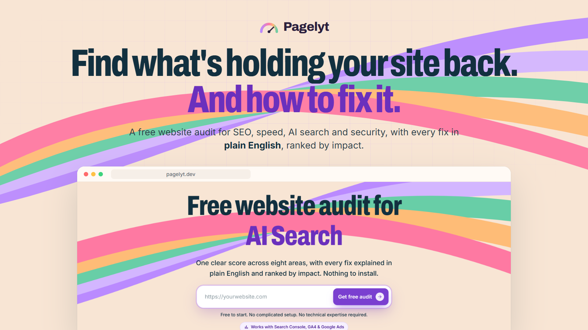
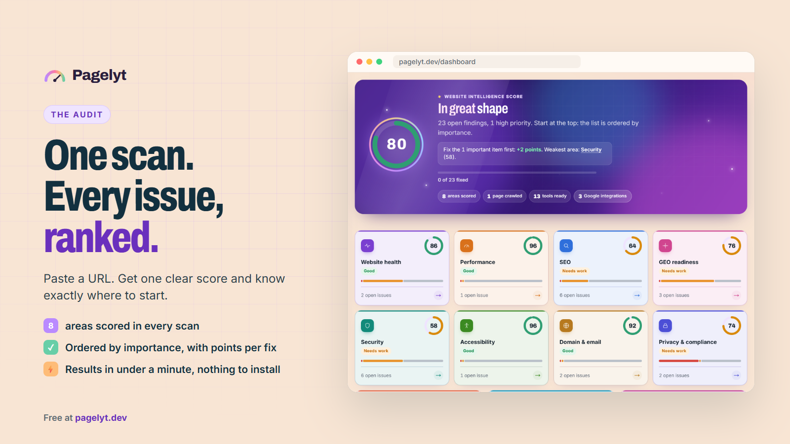
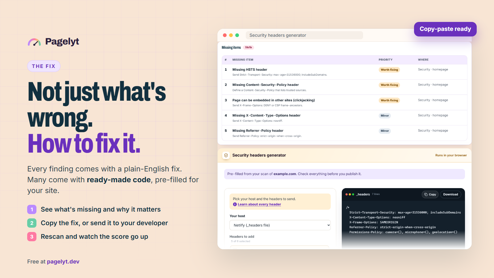
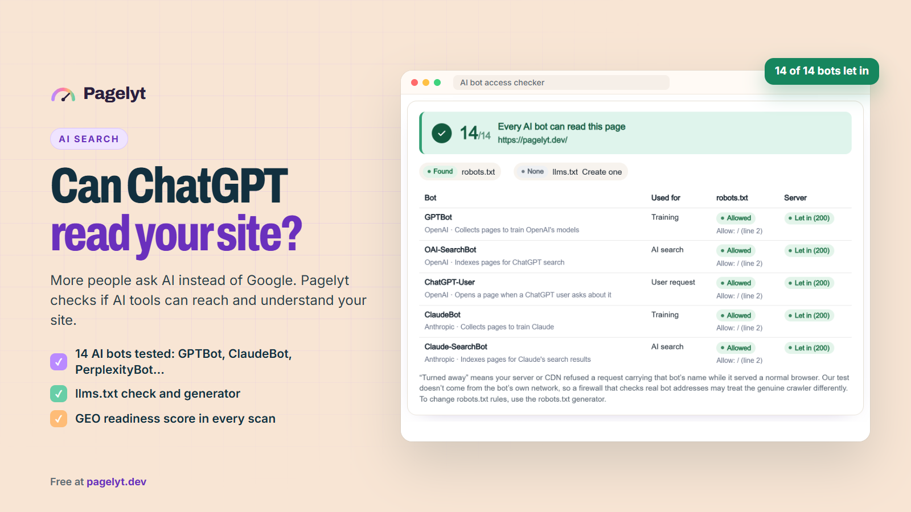
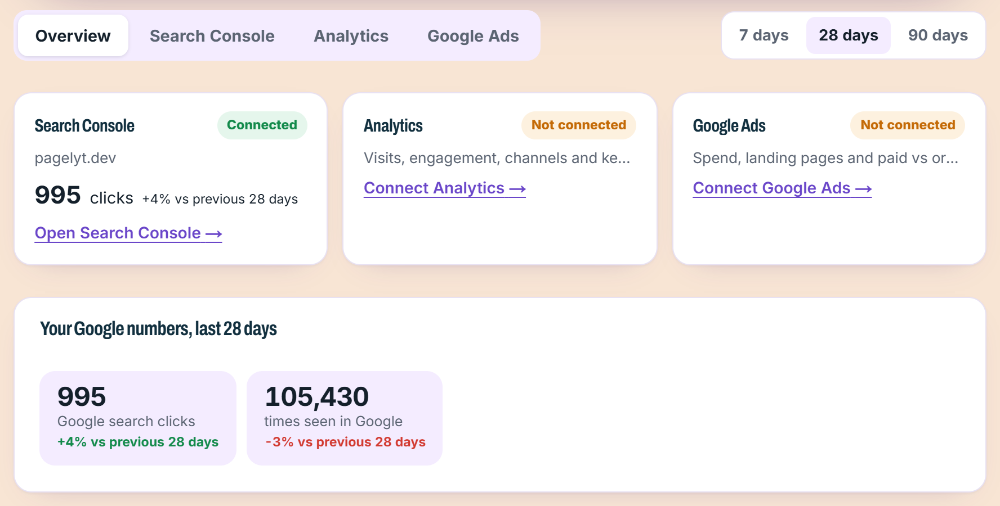
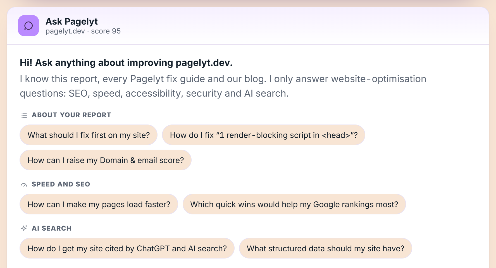
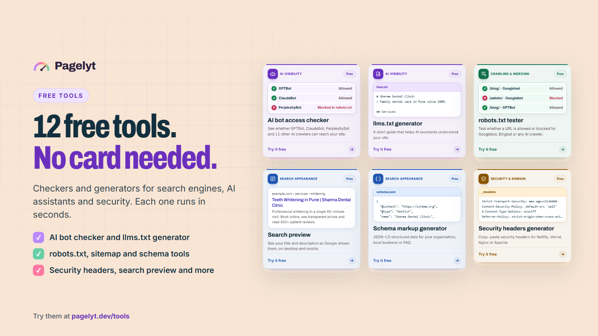

# Medium article: founder story (Sudharma)

Posted from: **Sudharma's personal Medium account** (founder voice, first person).
Images: `assets/medium/images/`, numbered in the order they appear.

## Before you publish (Medium story settings)

- **SEO title** (Story settings → SEO settings, max 60 chars):
  `Free Website Audit Tool: Why I Built Pagelyt`
- **SEO description** (max 156 chars):
  `I built Pagelyt, a free website audit that ranks every SEO, speed, AI search and security issue by impact and explains each fix in plain English.`
- **Tags** (Medium allows 5): `SEO`, `Website Audit`, `AI Search`, `Startup`, `Web Development`
- **Story preview image:** `01-cover.png`
- **Canonical link:** leave empty. This is an original post, not a copy of a pagelyt.dev blog post.
- **Publication:** submit to a publication if accepted somewhere (e.g. a startup or web dev publication). It gets far more reach than a personal feed.
- **Links:** every pagelyt.dev link already carries `utm_source=medium&utm_medium=article&utm_campaign=founder-story`.

---

## Title

**I Got Tired of Website Audits That Hand You 200 Warnings. So I Built Pagelyt.**

## Subtitle

A free website audit that ranks every issue by impact, explains the fix in plain English, and checks whether ChatGPT can actually read your site.

---

*Pagelyt: a free website audit for SEO, speed, AI search and security.*

The first time I ran a proper website audit on a site I cared about, I got 200 warnings back.

Red, orange, yellow. Missing alt text. Render-blocking resources. A Content-Security-Policy I'd never heard of. A "DMARC policy not found" that sounded serious but came with no explanation. I spent an evening copying error messages into search engines, and by the end of it I still didn't know the one thing I wanted to know:

**What should I fix first?**

That question is why I built [Pagelyt](https://pagelyt.dev/?utm_source=medium&utm_medium=article&utm_campaign=founder-story).

## The problem with most website audit tools

I'm not knocking the tools. Lighthouse is brilliant for page speed. The big SEO suites are built for SEO professionals and they're very good at that job. Security scanners find real problems.

But if you run a small business, freelance for clients, or build sites for a living, you end up with five tabs open and five different reports that don't talk to each other. Each one tells you what's wrong in its own corner. None of them tells you what matters most for *your* site, in words you can act on.

And they all assume you already know what an HSTS header is.

When I talked to business owners about their websites, I kept hearing the same three things:

1. "I don't know if my website is actually any good."
2. "I got a report, but I don't know where to start."
3. "My developer says it's fine. Is it?"

None of those is a data problem. They're a *reading* problem. The data exists. Nobody is reading it for you.

## What I wanted instead

I wrote down what I wanted from a website audit before I wrote any code:

- **One URL in, one clear answer out.** Not a dashboard of charts. A score, and a sentence about what it means.
- **Every issue ranked by impact.** If there are 23 things wrong, show me the one that matters most at the top, and tell me how many points it's worth.
- **The fix in plain English.** Not "configure HSTS." Tell me what it is, why it matters, and what to paste where.
- **Everything in one place.** Speed, SEO, security, accessibility, email setup, privacy, and the newest one: AI search.
- **Free to start, nothing to install.**

That list became Pagelyt.

## How Pagelyt works

You paste your website address. In under a minute, Pagelyt checks your site across nine areas:

- **Website health:** is the site up, is SSL valid, are there broken pages?
- **Performance:** Core Web Vitals and real page speed on mobile and desktop
- **SEO:** titles, descriptions, headings, indexing, sitemaps and structured data
- **GEO readiness:** can AI assistants like ChatGPT, Claude and Perplexity read and cite you?
- **Security:** HTTPS, security headers, mixed content
- **Accessibility:** WCAG checks, with a clear A and AA summary
- **Domain & email:** SPF, DKIM and DMARC, so your emails don't land in spam
- **Privacy & compliance:** cookies, trackers and privacy basics
- **Code security:** risky patterns in the code your site sends to every visitor

Then it rolls all of that into one score.

*One scan, one score, and a card for each area. The weakest area is called out at the top.*

The part I'm proudest of is the line at the top of the report. On the screenshot above it says: *fix the 1 important item first: +2 points. Weakest area: Security.*

That's the whole idea in one sentence. You don't need to read 23 findings. You need to know where to start, and what you get for it.

## Not just what's wrong. How to fix it.

A list of problems is only half a report. The other half is the fix.

Every finding in Pagelyt comes with a plain-English explanation: what it is, why it matters to your visitors or your Google ranking, and what to do about it. For many findings, Pagelyt goes one step further and gives you the code, already filled in for your site.

*Missing security headers, ranked by priority, with copy-paste code for your host.*

Missing security headers is a good example. Most audit tools tell you they're missing. Pagelyt lists which ones, ranks them, asks which host you use (Netlify, Vercel, Nginx, Apache), and hands you the exact file to paste. You can copy it yourself or send it to your developer. Then you rescan and watch the score go up.

That loop, **scan, fix, rescan**, is what makes a website audit actually useful. A report you read once and forget doesn't change anything.

## The thing most website audits miss: AI search

Here's what pushed me from "side project" to "this needs to exist."

More and more people don't Google things any more. They ask ChatGPT. They ask Perplexity. They see Google's AI Overview and never scroll down to the links. And AI search doesn't show ten blue links. It gives one answer and names a handful of sources.

If an AI assistant can't read your site, you're not one of them.

I started checking sites I knew, and the results surprised me. Plenty of perfectly good business websites were quietly blocking AI crawlers in `robots.txt`, usually by accident: a security plugin or a copied template that blocked GPTBot "just in case." Their owners had no idea.

So GEO (generative engine optimisation) is built into every Pagelyt scan.

*The AI bot access checker tests 14 AI crawlers against your robots.txt and your server.*

Pagelyt checks 14 AI bots, including GPTBot, OAI-SearchBot, ClaudeBot and PerplexityBot. It tests both your `robots.txt` rules and whether your server or CDN actually lets them in, which is a different thing and catches firewall problems that robots.txt checks miss. It also looks for an `llms.txt` file, a short guide that tells AI tools who you are and which pages matter, and helps you make one if you don't have it.

If GEO is new to you, I wrote a plain-English guide: [What is GEO? Generative engine optimisation explained](https://pagelyt.dev/blog/what-is-geo-generative-engine-optimisation?utm_source=medium&utm_medium=article&utm_campaign=founder-story).

## Connecting the audit to your real Google traffic

An audit tells you what's wrong with your site. It doesn't tell you what's costing you visitors.

So Pagelyt connects to Google Search Console, Google Analytics 4 and Google Ads. Once connected, you see your real numbers next to your audit: clicks, impressions, which pages people land on, and how they've changed over the last 7, 28 or 90 days.

*Your Google numbers next to your audit, so you can see which fixes touch the pages that bring in traffic.*

This changes which fix comes first. A slow page that nobody visits can wait. A slow page that brings in half your Google traffic can't. If you haven't set these up yet, there are step-by-step guides for [Google Search Console](https://pagelyt.dev/blog/google-search-console-setup-guide?utm_source=medium&utm_medium=article&utm_campaign=founder-story) and [Google Analytics 4](https://pagelyt.dev/blog/google-analytics-4-setup-guide?utm_source=medium&utm_medium=article&utm_campaign=founder-story).

## When you're stuck: Ask Pagelyt

Even with plain-English fixes, people get stuck. "What does this mean for *my* site?" "Which of these should I do this week?"

So there's an assistant built into the dashboard. Ask Pagelyt knows your whole report, every fix guide and every post on our blog. It only answers website questions: SEO, speed, accessibility, security and AI search. It won't write your marketing emails, and that's on purpose.

*Ask Pagelyt answers questions about your own report, like "What should I fix first on my site?"*

## 13 free tools, no card needed

Not every problem needs a full audit. Sometimes you just want to check one thing.

*A few of the free tools. Each one runs in seconds.*

Pagelyt has 13 free tools, including:

- [AI bot access checker](https://pagelyt.dev/tools/ai-bot-checker?utm_source=medium&utm_medium=article&utm_campaign=founder-story): can ChatGPT, Claude and Perplexity reach your site?
- [llms.txt generator](https://pagelyt.dev/tools/llms-txt-generator?utm_source=medium&utm_medium=article&utm_campaign=founder-story): make one in a minute
- robots.txt tester and generator
- Schema markup generator and bulk schema checker
- Security headers generator
- XML sitemap generator, search preview, hreflang checker and more

See them all at [pagelyt.dev/tools](https://pagelyt.dev/tools?utm_source=medium&utm_medium=article&utm_campaign=founder-story).

## What I've learned building it

A few things surprised me while building Pagelyt:

**People don't want more data. They want a decision.** Every time I added a chart, nobody looked at it. Every time I made the "fix this first" line clearer, people used it.

**Plain English is harder than code.** Writing "Missing HSTS header" takes one second. Writing a sentence a café owner understands, that is still technically correct, takes a lot longer. It's also the part people thank me for.

**Most websites have the same five problems.** Missing meta descriptions, unoptimised images, no security headers, email without DMARC, and AI bots blocked by accident. If you fix just those, you're ahead of most sites in your market.

**AI search is moving faster than anyone's website.** The sites that make themselves easy for AI assistants to read now will be the ones those assistants recommend later.

## Who Pagelyt is for

- **Small business owners** who want to know whether their website is actually working for them
- **Freelancers and agencies** who audit client sites and want a clear report they can share
- **Developers** who want a fast second opinion before launch
- **Anyone** who has ever been handed a 200-line audit and wondered where to start

## Try it on your own site

Pagelyt is free to start, with nothing to install. Paste your URL at [pagelyt.dev](https://pagelyt.dev/?utm_source=medium&utm_medium=article&utm_campaign=founder-story) and you'll have your score, your weakest area and your first fix in under a minute.

I read every message that comes in. If you run it on your site, I'd genuinely love to hear what came up as your top fix, and what you'd want Pagelyt to check next. Leave a comment below.

*Sudharma, founder of Pagelyt*

---

## Image list (upload in this order)

| # | File | Where it goes | Alt text |
|---|------|---------------|----------|
| 1 | `01-cover.png` | Top of the story, and the story preview image | Pagelyt homepage: Find what's holding your site back. And how to fix it. |
| 2 | `02-audit-score.png` | "How Pagelyt works" | Pagelyt audit dashboard showing an overall score of 80 and a score card for each area |
| 3 | `03-fix-with-code.png` | "Not just what's wrong" | Pagelyt security headers generator with missing headers listed by priority and copy-paste code for Netlify |
| 4 | `04-ai-bot-checker.png` | "AI search" | Pagelyt AI bot access checker showing 14 of 14 AI bots allowed, including GPTBot, ClaudeBot and PerplexityBot |
| 5 | `05-google-insights.png` | "Connecting the audit to your real Google traffic" | Pagelyt Google overview with Search Console connected, showing 995 clicks and 105,430 impressions over 28 days |
| 6 | `06-ask-pagelyt.png` | "Ask Pagelyt" | Ask Pagelyt assistant with suggested questions about the report, speed, SEO and AI search |
| 7 | `07-free-tools.png` | "13 free tools" | Pagelyt free tools: AI bot access checker, llms.txt generator, robots.txt tester, search preview, schema markup generator and security headers generator |

Medium sets alt text from the image's "Alt text" option (click the image, then the alt text icon). Captions are typed directly under the image.

## Posting tips

- Publish Tue–Thu morning. Share it from LinkedIn and the Pagelyt company page the same day with one line of your own.
- Add the Medium link to the Pagelyt Peerlist profile and LinkedIn featured section.
- Reply to every comment in the first 48 hours. Medium surfaces stories with early engagement.
- After a week, check the Medium stats "referrers" and the GA4 `utm_source=medium` traffic.
